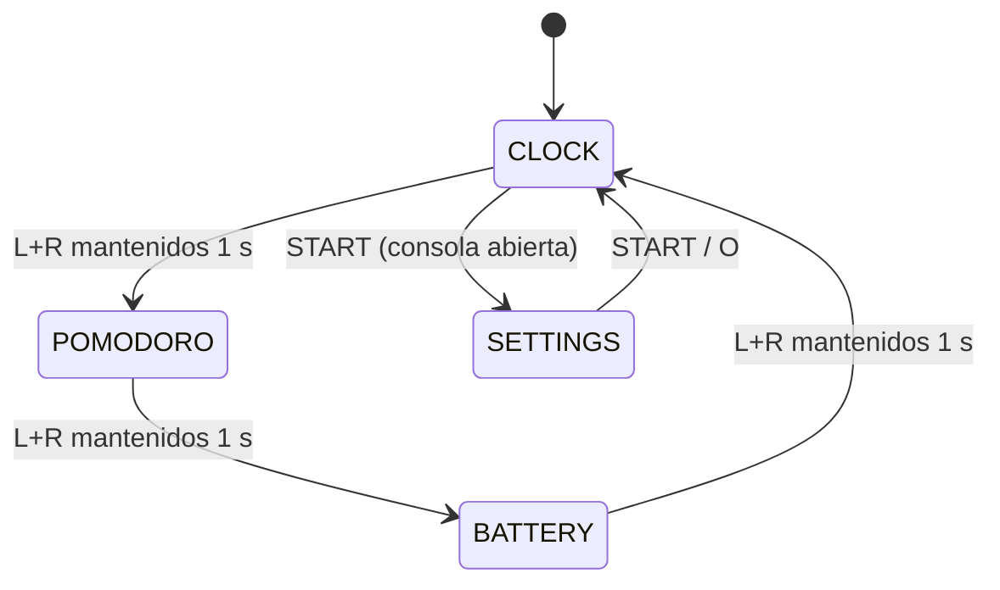
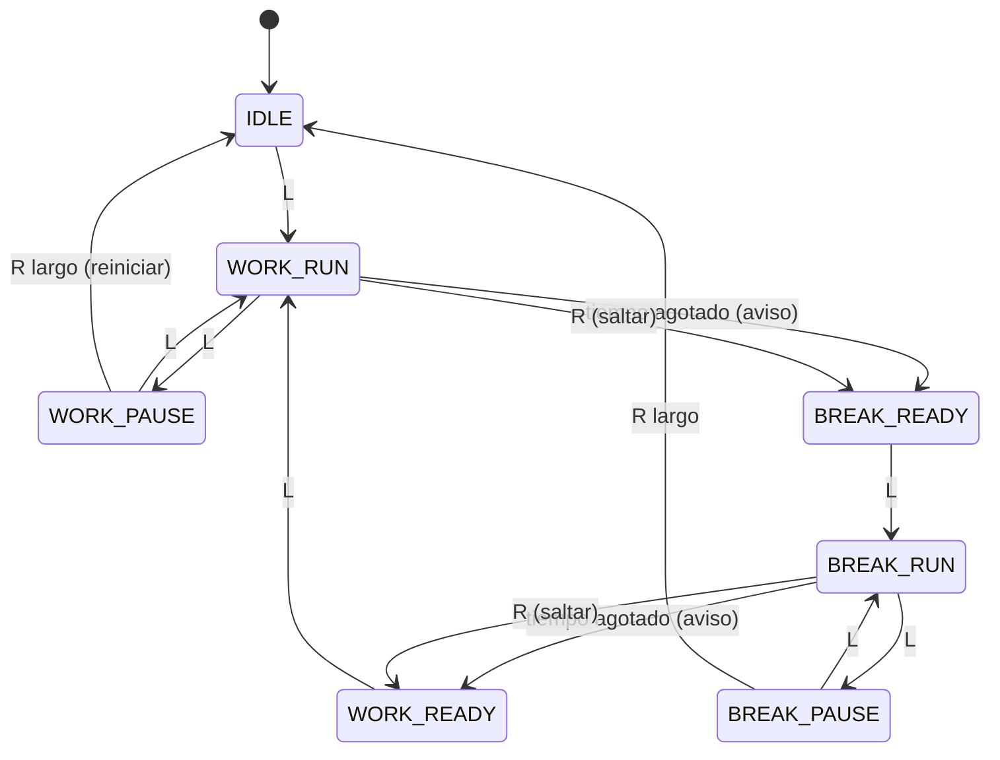

# 01_DeskClock_Pomodoro — Especificación lógica (v1)

> Estado: **IMPLEMENTADO Y VALIDADO EN HARDWARE REAL (v1.0 Producción)**.
> Plataforma: PSP Go (N1000), 6.60 PRO-C, almacenamiento `ef0:`. Toolchain: `pspdev` (GCC 15.2.0).

---

## 1. Objetivo y alcance

Una app nativa (`EBOOT.PBP`) que convierte la PSP Go, cerrada y apoyada en la mesa, en:

1. **Reloj** de sobremesa grande y legible.
2. **Temporizador Pomodoro** que se maneja **solo con L y R** (los botones accesibles con la consola cerrada).
3. **Panel de batería** con telemetría real del hardware.

| Versión | Alcance |
|---|---|
| **v1 (este documento)** | App autónoma que se abre desde *Juego → Memoria del sistema*. Todas las funciones de arriba. |
| **v2 (más adelante)** | Que se abra **sola al cerrar el slider** en el XMB (plugin tipo `NewSlide.prx` o PRX propio). |

Fuera de alcance en v1: red, sincronizar la hora por NTP, cambiar el brillo (ver §9).

---

## 2. Resultados Reales de la Fase 0 (Prueba en Hardware Real)

Las pruebas realizadas con `00_Probe` en la PSP Go física han arrojado resultados concluyentes:

| # | Pregunta | Resultado en Hardware | Decisión de Diseño Adoptada |
|---|---|---|---|
| **P1** | ¿Se detecta el cierre del slider en modo usuario? | **NO.** Al abrir/cerrar la pantalla no cambia ningún bit en `sceCtrl` ni se emite callback en `scePower`. | El diseño no depende del sensor físico: la interfaz está optimizada para verse perfecta tanto abierta como cerrada, y el cambio de modo/pantalla se realiza mediante el combo **L+R** (1 s). |
| **P2** | ¿La app se congela o suspende al cerrar el slider? | **NO. Sigue corriendo al 100% (60 FPS sin ningún GAP de tiempo).** | **¡Excelente resultado!** El reloj y el temporizador Pomodoro funcionan de forma continua e ininterrumpida con la consola cerrada encima de la mesa o en un dock. |
| **P3** | ¿Qué botones funcionan con la consola cerrada? | **L, R y el botón PS.** Los botones de volumen los gestiona directamente el hardware/firmware sin pasar al buffer de usuario. | El esquema de control diseñado basado exclusivamente en **L y R** (toque L = pausa/play, toque R = skip, R largo = reset, combo L+R = cambio de pantalla) es 100% viable y compatible con la consola cerrada. |

---

## 3. Arquitectura en módulos

Separación estricta: la **lógica pura** (sin llamadas a la PSP) va aparte de la **capa de plataforma**. Así la lógica se puede probar en el Mac con `clang` antes de tocar la consola.

```
src/
├── main.c            Bucle principal, init/shutdown, conecta todos los módulos
├── platform/         ── Depende del SDK de PSP ──
│   ├── psp_sys.c     Callback de salida (HOME), hilo de callbacks, frecuencia de CPU, scePowerTick
│   ├── psp_input.c   Lee sceCtrl → InputFrame {buttons, now_ms}
│   ├── psp_clock.c   sceRtcGetCurrentTick / sceRtcGetCurrentClockLocalTime → milisegundos / fecha
│   ├── psp_battery.c scePowerGetBattery* → BatteryInfo
│   ├── psp_audio.c   Pitido generado por código (sin archivos de sonido)
│   └── psp_gfx.c     Init de GU, rectángulos, texto con intraFont, inicio/fin de frame
├── core/             ── C puro, se prueba en el Mac ──
│   ├── input_logic.c Detección de flancos, pulsación larga, combo L+R
│   ├── pomodoro.c    Máquina de estados del Pomodoro
│   ├── app_state.c   Pantalla activa + qué input va a cada sitio
│   ├── config.c      Leer/escribir config.ini (valores por defecto + límites)
│   └── stats.c       Contadores de sesiones (hoy / total)
├── ui/
│   ├── digits.c      Dígitos grandes de 7 segmentos dibujados con rectángulos de GU
│   ├── screen_clock.c
│   ├── screen_pomo.c
│   └── screen_battery.c
└── tests/            Tests en el Mac para core/ (compilados con clang, no con psp-gcc)
```

Dependencias: `ui → core` (solo lectura), `main → todo`, `core → nada`.

### Librerías elegidas (todas están ya en `pspdev`)
- **libpspgu**: dibujo 2D acelerado por hardware.
- **intraFont**: texto pequeño usando las fuentes que ya trae la PSP (`flash0:/font/*.pgf`), sin añadir archivos de fuentes.
- **Dígitos grandes**: geometría propia de 7 segmentos (rectángulos). Motivo: intraFont escalado a ~120 px se ve borroso; los rectángulos quedan nítidos a cualquier tamaño y cuestan muy poco.
- libpsppower, libpsprtc, libpspaudio, libpspctrl.
- *Se descarta SDL2* para la v1: más pesado y no aporta nada para una interfaz tan sencilla.

---

## 4. Pantallas y máquina de estados de la app



| Pantalla | Contenido |
|---|---|
| **CLOCK** | `HH:MM` gigante, segundos pequeños, fecha (`Mié 15 Oct`), icono de batería con %. Si hay un Pomodoro en marcha, una línea con `🍅 12:34` abajo. |
| **POMODORO** | `MM:SS` gigante con la cuenta atrás, fase (TRABAJO / DESCANSO / DESCANSO LARGO), barra de progreso, 4 puntos de ciclo, nº de sesiones de hoy. |
| **BATTERY** | %, tiempo restante, voltaje (V), temperatura (°C), cargando o no, conectada a corriente o no, capacidad restante/total (mAh). |
| **SETTINGS** | Duraciones, 12/24 h, tema, sonido. Solo con la consola **abierta** (usa la cruceta). |

El Pomodoro **sigue corriendo en segundo plano** aunque se cambie de pantalla.

---

## 5. Mapeo de controles

### Con la consola cerrada (solo L y R)
| Gesto | CLOCK | POMODORO | BATTERY |
|---|---|---|---|
| **L** (toque) | — | Iniciar / Pausar / Reanudar | — |
| **R** (toque) | — | Saltar a la fase siguiente | — |
| **R** mantenido 1,5 s | — | Reiniciar el ciclo completo | — |
| **L+R** mantenidos 1 s | Pantalla siguiente | Pantalla siguiente | Pantalla siguiente |
| **L** mantenido 1,5 s | Ir directo al Pomodoro y empezar | — | — |

### Con la consola abierta (extras)
- **START** → Ajustes · **Cruceta** → navegar · **X** confirmar · **O** volver.
- **HOME/PS** → salida estándar del sistema (callback de salida).

### Reglas de entrada (`input_logic.c`)
- **Toque** = flanco de *soltar* con duración < 600 ms **y** sin que el otro gatillo se haya pulsado mientras tanto (si no, L+R dispararía también L y R sueltos).
- **Pulsación larga** = se dispara **una sola vez** al cruzar el umbral, sin esperar a soltar.
- **Combo L+R** = ambos pulsados ≥ 1000 ms; anula los toques sueltos de esa pulsación.
- Todos los tiempos se miden en milisegundos reales (§6), nunca contando frames.

---

## 6. Medición del tiempo

- **Fuente única de tiempo:** `sceRtcGetCurrentTick()` ÷ `sceRtcGetTickResolution()` → `now_ms` (u64). Se lee una vez por frame y se pasa a todos los módulos (los módulos de `core` nunca leen el reloj por su cuenta → se pueden testear).
- **Hora del reloj:** `sceRtcGetCurrentClockLocalTime()` (respeta la zona horaria configurada en la PSP).
- **El Pomodoro no cuenta frames.** Guarda `phase_started_ms` y `accumulated_ms`:
  - `restante = duración − (accumulated_ms + (corriendo ? now_ms − phase_started_ms : 0))`
  - Así, si hay tirones, el sistema se suspende o el bucle va a 30 fps, la cuenta sigue siendo exacta (cuenta el tiempo real transcurrido).
- Al volver de una suspensión con una fase ya terminada: se pasa a la fase siguiente **en pausa** (no se encadenan varias fases en silencio) y se avisa.

---

## 7. Máquina de estados del Pomodoro (`pomodoro.c`)



- **Descanso corto / largo:** después de la sesión de trabajo nº `long_break_every` (4 por defecto), el descanso es largo.
- Los estados `*_READY` hacen que el siguiente bloque **no empiece solo** (se puede cambiar con `auto_start = 1`).
- Una sesión de trabajo **solo cuenta en las estadísticas si se completa** (saltarla con R no suma).
- R largo reinicia desde cualquier estado → `IDLE`, contador de ciclo a 0.

Interfaz pública (propuesta):
```c
void pomo_init(Pomo*, const PomoConfig*);
void pomo_on_toggle(Pomo*, u64 now_ms);   // L
void pomo_on_skip(Pomo*, u64 now_ms);     // R
void pomo_on_reset(Pomo*);                // R largo
PomoEvent pomo_update(Pomo*, u64 now_ms); // devuelve NONE / PHASE_DONE
u32  pomo_remaining_ms(const Pomo*, u64 now_ms);
```

---

## 8. Avisos al terminar una fase
- **Sonido:** 3 pitidos cortos (onda cuadrada de 880 Hz generada por código con `sceAudio`), en un hilo aparte para no bloquear el dibujo. Respeta el volumen de la consola. Se puede desactivar.
- **Visual:** la pantalla parpadea invirtiendo colores durante 3 s.
- **Indicador:** el texto de la fase cambia a `¡DESCANSO!` / `¡A TRABAJAR!` hasta que se pulse L.

---

## 9. Energía, pantalla y desgaste

| Tema | Decisión |
|---|---|
| **Que no se apague sola** | La PSP apaga la pantalla o se suspende por inactividad. Llamar a `scePowerTick(PSP_POWER_TICK_ALL)` cada ~5 s mientras la app está abierta. *Imprescindible para un reloj de mesa.* |
| **Frecuencia de CPU** | `scePowerSetClockFrequency(133, 133, 66)` al arrancar (hay muy poco que dibujar). Volver a 222 si hiciera falta. Ahorra batería. |
| **Cuánto se redibuja** | El bucle se sincroniza con el refresco de pantalla (vblank), pero **solo se dibuja un frame nuevo si algo ha cambiado** (cambio de segundo, entrada, animación). El resto del tiempo el hilo duerme. |
| **Brillo** | `sceDisplaySetBrightness` **solo existe en modo kernel** → la v1 no puede atenuar la pantalla. Solución: tema oscuro por defecto (fondo negro, dígitos tenues). Atenuar de verdad queda para v2 (PRX en kernel). |
| **Marcas en la pantalla** | El LCD de la PSP Go apenas sufre retención, pero por si acaso el contenido se desplaza 1–2 px cada minuto (*pixel shift*). |

---

## 10. Telemetría de batería (`psp_battery.c`)

Se lee **cada 5 s** (no en cada frame) y se guarda en un `BatteryInfo`.

| Campo | API | Unidad / cuidado |
|---|---|---|
| Porcentaje | `scePowerGetBatteryLifePercent()` | 0–100; **negativo = error / sin batería** |
| Tiempo restante | `scePowerGetBatteryLifeTime()` | minutos; negativo con el cargador puesto → mostrar `--` |
| Voltaje | `scePowerGetBatteryVolt()` | mV → mostrar `3,87 V` |
| Temperatura | `scePowerGetBatteryTemp()` | °C |
| Cargando | `scePowerIsBatteryCharging()` | 0/1 |
| Corriente externa | `scePowerIsPowerOnline()` | 0/1 |
| Capacidad | `scePowerGetBatteryRemainCapacity()` / `…FullCapacity()` | mAh |

Cualquier valor negativo se trata como "no disponible" y se muestra `--`. Nunca se usa en cálculos.

---

## 11. Persistencia

**Ruta:** en la propia carpeta de la app, calculada a partir de `argv[0]` o `getcwd()` (la misma técnica que usa FuSa). **Nunca se escribe a mano `ms0:` ni `ef0:`.**

`config.ini` (se crea con estos valores por defecto si no existe; cualquier valor fuera de rango se corrige):
```ini
[pomodoro]
work_min=25          ; 1–90
short_break_min=5    ; 1–30
long_break_min=15    ; 1–60
long_break_every=4   ; 2–8
auto_start=0         ; 0/1
sound=1              ; 0/1

[clock]
format_24h=1         ; 0/1
show_seconds=1       ; 0/1
theme=dark           ; dark | amber | green | white
pixel_shift=1        ; 0/1
```

`stats.dat` (binario, con versión): `{magic, version, day_yyyymmdd, sessions_today, sessions_total, focus_minutes_total}`. Si cambia el día, `sessions_today` vuelve a 0.

**Cuidar la memoria flash:** solo se escribe al completar una sesión, al guardar los ajustes y al salir. Nunca en cada frame.

---

## 12. Temas
Cada tema = 3 colores (fondo, principal, secundario). `dark`: negro / gris claro / gris oscuro (por defecto, el que menos se ve de noche). `amber` / `green`: estilo pantalla monocromo antigua. `white`: para usar de día.

---

## 13. Plan de pruebas

1. **Tests en el Mac (`tests/`, clang):** `pomodoro.c`, `input_logic.c`, `config.c` y `stats.c` con un reloj simulado. Casos mínimos: pausa/reanudar mantiene el tiempo exacto; volver de una suspensión con la fase agotada; un combo L+R no dispara toques sueltos; config con valores fuera de rango o líneas rotas; cambio de día en las estadísticas.
2. **Emulador PPSSPP en el Mac:** dibujo, pantallas, avisos.
3. **PSP Go real:** Fase 0 (P1–P3), consumo de batería en 1 h con la consola cerrada, comprobar que no se apaga sola.

---

## 14. Hoja de ruta

| Fase | Entrega | Cuándo está terminada |
|---|---|---|
| **0** | `00_Probe` | Respuestas a P1, P2 y P3 apuntadas en este documento |
| **1** | `core/` + tests en el Mac | Todos los tests pasan |
| **2** | Plataforma + pantalla CLOCK | Reloj correcto en la PSP, no se apaga sola, salida con HOME |
| **3** | Pantalla POMODORO + avisos | Ciclo completo manejado solo con L/R y la consola cerrada |
| **4** | BATTERY + SETTINGS + persistencia | Los ajustes y las estadísticas sobreviven a un reinicio |
| **5** | Pulido: temas, pixel shift, icono `ICON0.PNG` | Uso diario cómodo |
| **v2** | Abrir al cerrar el slider (PRX) + brillo | Se abre sola al cerrar la consola en el XMB |

---

## 15. Decisiones pendientes del usuario
1. Duraciones por defecto: ¿25/5/15 con descanso largo cada 4?
2. Tema por defecto: ¿`dark`, `amber`, `green` o `white`?
3. ¿Sonido activado por defecto?
4. ¿Formato 24 h?
5. ¿Idioma de la interfaz: español?
