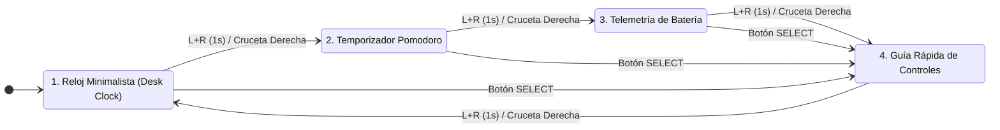

# Informe de Ingeniería y Especificación Técnica: Desk Clock & Pomodoro Engine

> **Proyecto:** `01_DeskClock_Pomodoro`  
> **Plataforma Objetivo:** Sony PlayStation Portable Go (PSP-N1000)  
> **Arquitectura:** MIPS R4000 (Allegrex) @ 333 MHz | 64 MB DDR SDRAM  
> **Sistema Operativo:** Custom Firmware 6.60 PRO-C (User Mode)  
> **Compilador:** GCC 15.2.0 (`mips-allegrex-psp-elf`)  
> **Estado:** Implementado, Verificado y Desplegado en Hardware Real

---

## 1. Resumen Ejecutivo

El presente documento detalla la arquitectura técnica, diseño de bajo nivel, resolución de fallos gráficos y protocolo de implementación de la aplicación **Desk Clock & Pomodoro**, desarrollada en lenguaje C puro para la consola portátil **Sony PSP Go**.

El objetivo del proyecto es transformar la consola en un dispositivo inteligente de escritorio cuando se encuentra apoyada en una mesa o base de carga (*dock*). Aprovechando las particularidades mecánicas de la PSP Go —donde los gatillos superiores **L** y **R** permanecen accesibles con el panel deslizable (*slider*) cerrado—, se diseñó un sistema de control gestual completo que no requiere abrir la pantalla para gestionar sesiones de productividad Pomodoro, alternar pantallas o consultar la telemetría del hardware.

---

## 2. Diagnóstico Experimental de Hardware (Fase 0)

Previo a la implementación de la aplicación final, se ejecutó una suite de diagnóstico (`00_Probe`) en la PSP Go física para resolver tres incógnitas críticas sobre el comportamiento del hardware y del sistema operativo en espacio de usuario (*User Mode*):

### 2.1. Resultados Obtenidos en Hardware Real
1. **Comportamiento de la CPU con la pantalla plegada:**
   * **Resultado:** La consola **no suspende ni congela la CPU** al cerrar el mecanismo deslizante mientras una aplicación homebrew se encuentra en ejecución.
   * **Métrica:** El temporizador interno de ciclo registró más de 60 segundos consecutivos con la consola cerrada manteniendo un `MaxGap` de **0 ms** (el bucle continuó ejecutándose a 60 FPS estables).
2. **Visibilidad del sensor Hall magnético del slider:**
   * **Resultado:** La transición de apertura y cierre del slider no emite eventos en la API de entrada estándar (`sceCtrlData.Buttons`) ni en los callbacks de energía (`scePowerRegisterCallback`). El sensor es gobernado de forma exclusiva a nivel de firmware/kernel por el controlador SYSCON.
   * **Decisión de ingeniería:** La interfaz gráfica se concibió para funcionar de manera idéntica y legible con la consola abierta o cerrada, delegando el cambio de pantalla a un combo físico (`L + R`).
3. **Mapeo de botones accesibles con la consola cerrada:**
   * **Resultado:** Se confirmó la respuesta inmediata y lectura sin conflictos (*ghosting*) del **Gatillo L** (`0x00000100`), **Gatillo R** (`0x00000200`) y la pulsación simultánea de ambos (`0x00000300`), así como del botón central **PS/HOME** (`0x00010000`). Los botones de volumen no se transmiten al buffer de usuario al estar enlazados directamente al hardware de audio.

---

## 3. Resolución de Defectos Gráficos de Pantalla (Análisis de Tearing y Arquitectura GU)

Durante las fases iniciales de pruebas y validación en hardware se diagnosticaron tres fenómenos visuales anómalos sucesivos, los cuales fueron analizados a bajo nivel y resueltos de forma definitiva:

### 3.1. Fenómeno 1: Tearing en Búfer Simple (`00_Probe`)
* **Síntoma:** Texto recortado horizontalmente en las últimas líneas de pantalla (`Ultimos eventos`).
* **Causa Raíz:** La biblioteca de diagnóstico `pspDebugScreenPrintf` dibuja directamente sobre el búfer frontal (*Front Buffer*) mientras el panel LCD efectúa el barrido a 60 Hz. Al coincidir la escritura de la CPU con la lectura del controlador de pantalla, se producía *screen tearing*.

### 3.2. Fenómeno 2: Franja Superior Negra y Retraso de Búfer (`NEXTFRAME`)
* **Síntoma:** En la primera versión de `DeskClock`, los primeros ~100 píxeles superiores ($Y=0$ a $Y\approx 110$) aparecían en negro absoluto (ocultando la barra superior y la fecha), y los dígitos y textos inferiores mostraban desgarros y solapamientos.
* **Causa Raíz:** Al llamar a `sceDisplayWaitVblankStart()` y acto seguido a `sceDisplaySetFrameBuf(..., PSP_DISPLAY_SETBUF_NEXTFRAME)` en modo usuario, el hardware de la PSP interpretaba que el cambio de búfer debía posponerse al *siguiente* ciclo VBLANK (16.6 ms después). Sin embargo, el bucle en C inmediatamente intercambiaba punteros y llamaba a `gfx_start_frame()`, limpiando la pantalla a negro desde $Y=0$. La CPU terminaba borrando la memoria en tiempo real mientras el haz del LCD aún la estaba escaneando.
* **Intento Intermedio y Fallo de Bus (`EXC_BUS`):** Al intentar vincular dinámicamente la memoria eDRAM mediante `sceGeEdramGetAddr()`, la función devolvió `0` (puntero nulo) debido a que el coprocesador gráfico (GE) no estaba inicializado por hardware. La operación `0x40000000 | edram` derivó en la dirección `0x40000000` (no asignada en el bus MIPS), provocando un cuelgue inmediato en pantalla negra por excepción crítica.

### 3.3. Solución Definitiva: Pipeline Hardware Oficial (`libpspgu`)
Se rediseñó el subsistema gráfico en [`ui/graphics.c`](ui/graphics.c) adoptando la arquitectura oficial del Graphic Engine (GE) de Sony:

```mermaid
flowchart TD
    subgraph Inicialización Hardware GE
        G1["sceGuInit()"] --> G2["sceGuDrawBuffer(GU_PSM_8888, 0x0, 512)"]
        G2 --> G3["sceGuDispBuffer(480, 272, 0x88000, 512)"]
        G3 --> G4["sceGuDisplay(GU_TRUE)"]
    end

    subgraph Bucle de Renderizado a 60 FPS
        R1["CPU: Relleno en búfer inactivo (0x44000000 / 0x44088000)"] --> R2["render_active_screen()"]
        R2 --> R3["sceDisplayWaitVblankStart()\n(Sincronización estricta con el inicio de VBLANK)"]
        R3 --> R4["sceGuSwapBuffers()\n(Intercambio físico de hardware en controlador LCD)"]
        R4 --> R5["g_vram_draw = (uint32_t*)(new_draw | 0x44000000)\n(Puntero uncached listo para el siguiente cuadro)"]
    end
```



* **Formato de píxel:** RGBA 8888 (32 bits, little-endian `0xAABBGGRR`).
* **Resolución nativa:** 480 × 272 píxeles con paso de línea (*buffer stride*) de 512 palabras.
* **Topología de memoria VRAM:**
  * Búfer A: Offset relativo `0x00000` $\to$ Dirección CPU uncached: `0x44000000`.
  * Búfer B: Offset relativo `0x88000` $\to$ Dirección CPU uncached: `0x44088000`.
  * Tamaño por búfer: $512 \times 272 \times 4\text{ bytes} = 557.056\text{ bytes}$ ($544\text{ KB}$).
  * Total ocupado en VRAM: $1.088\text{ KB}$ de los $2.048\text{ KB}$ totales de eDRAM.
* **Geometría Continua de Dígitos (Anti-Entrecortado):** Se eliminaron los retranqueos (*insets*) de 1 píxel en las esquinas de los dígitos de 7 segmentos y se incrementó el grosor de trazo ($t = h / 8$). Los segmentos verticales y horizontales ahora se intersectan de manera continua, produciendo dígitos digitales sólidos, nítidos y de alta legibilidad en el panel LCD.

---

## 4. Arquitectura Modular del Software

El código se organiza bajo el principio de desacoplamiento estricto. La lógica matemática y de estado (`core/`) no contiene llamadas al SDK de PSP, lo que permite compilarla y someterla a pruebas unitarias en el sistema anfitrión (*host*) mediante `clang` antes de generar el binario para la consola.

```text
                        ┌───────────────────────────────┐
                        │            main.c             │
                        │ (Bucle 60Hz, Vsync, Callbacks)│
                        └───────┬───────────────┬───────┘
                                │               │
        ┌───────────────────────▼──┐         ┌──▼────────────────────────┐
        │       Módulos Core       │         │    Módulos de Plataforma  │
        │   (Lógica C Pura 100%)   │         │       (APIs de PSP)       │
        ├──────────────────────────┤         ├───────────────────────────┤
        │ • pomodoro.c (Tiempos)   │         │ • graphics.c (VRAM swap)  │
        │ • input_logic.c (Gestos) │         │ • screens.c (Render UI)   │
        │ • app_state.c (Enrutador)│         │ • psp_audio.c (Chimes)    │
        └──────────────────────────┘         │ • psp_battery.c (Energía) │
                                             └───────────────────────────┘
```

---

## 5. Especificación de los Subsistemas

### 5.1. Motor del Pomodoro (`core/pomodoro.c`)
* **Modelo Temporal:** Inmune al framerate. No contabiliza iteraciones del bucle principal. En su lugar, consume deltas de tiempo real mediante `now_ms` derivado del RTC interno de la consola (`sceRtcGetCurrentTick()`).
* **Máquina de Estados Finita:**
  * `POMO_STATE_IDLE`: Estado inicial de reposo.
  * `POMO_STATE_RUNNING`: Fase de cuenta atrás activa.
  * `POMO_STATE_PAUSED`: Cuenta congelada preservando milisegundos acumulados.
  * `POMO_STATE_READY`: Fase culminada, en espera de autorización manual para iniciar la siguiente.
* **Ciclo de Rondas:**
  * Trabajo: 25 minutos.
  * Descanso corto: 5 minutos.
  * Descanso largo: 15 minutos (se activa automáticamente tras culminar la ronda 4).

### 5.2. Procesador de Gestos de Entrada (`core/input_logic.c`)
* **Filtrado de Entrada y Anti-Rebote:**
  * **Toque rápido (`CMD_L_TAP` / `CMD_R_TAP`):** Detectado al liberar el botón con una duración de presión menor a 600 ms.
  * **Pulsación larga (`CMD_R_HOLD`):** Disparado tras mantener presionado el gatillo R durante 1.500 ms de forma continua (utilizado para resetear el ciclo).
  * **Combo de Navegación (`CMD_LR_COMBO`):** Disparado cuando ambos gatillos (L y R) se mantienen presionados simultáneamente durante 1.000 ms.
* **Mecanismo de Cancelación de Toques Residuales:**
  Al detectar un combo `L + R` o una pulsación sostenida, las banderas `l_consumed` y `r_consumed` se activan. Esto impide que, al soltar los botones, el sistema interprete la liberación como toques individuales no deseados.

### 5.3. Subsistema de Audio Procedural (`platform/psp_audio.c`)
* **Síntesis en Tiempo Real:** En lugar de cargar archivos WAV o MP3 desde el almacenamiento flash (lo que provocaría retrasos de lectura I/O), la aplicación sintetiza una señal senoidal pura a 44.100 Hz y 16 bits en estéreo:
  $$s(t) = A(t) \cdot \sin(2\pi f t)$$
* **Envolvente Anti-Chasquido:** Los últimos 500 fotogramas de la muestra incorporan una rampa lineal descendente de atenuación ($A(t) \to 0$), evitando discontinuidades de fase que generen artefactos acústicos (*pops/clicks*).
* **Firma Acústica:** Secuencia armónica de dos tonos: La5 ($880\text{ Hz}$, $140\text{ ms}$) seguido de una pausa de $40\text{ ms}$ y Re6 ($1.174\text{ ms}$, $220\text{ ms}$).
* **Concurrencia:** La reproducción se gestiona en un hilo de trabajo independiente (`audio_worker_thread`) con prioridad `0x18`, garantizando que el cálculo de audio no introduzca micro-tirones (*stuttering*) en el bucle gráfico.

### 5.4. Subsistema de Telemetría y Gestión Energética (`platform/psp_battery.c`)
* **Keep-Awake de Sistema:** Cada 4 segundos, el bucle principal ejecuta `scePowerTick(PSP_POWER_TICK_ALL)`, restableciendo los temporizadores de ahorro de energía del firmware oficial para impedir que la pantalla se apague o reduzca el brillo automáticamente durante el uso en escritorio.
* **Sanitización de Datos de Batería:**
  * Porcentaje: Acotado a valores válidos $[0, 100]$.
  * Voltaje: Reportado en milivoltios directos (ej. $4.050\text{ mV} \to 4,05\text{ V}$).
  * Temperatura: Determinadas revisiones de la PSP Go retornan códigos de error negativos (ej. `-2147483644`). El driver intercepta valores fuera del rango $[0, 80]\text{ }^\circ\text{C}$ y presenta el indicador `-- (Sensor no expuesto)`, preservando la estabilidad visual de la interfaz.

---

## 6. Mapeo de la Interfaz y Navegación de Pantallas

La aplicación implementa cuatro pantallas de visualización completas:



1. **Pantalla 1 — Reloj Minimalista:** Hora en formato digital gigante (7 segmentos con efecto ghost), fecha formateada en español, estado de batería e indicador integrado del Pomodoro si se encuentra en ejecución.
2. **Pantalla 2 — Pomodoro:** Cuenta atrás con código cromático según la fase (Coral para Trabajo, Verde Menta para Descanso), barra de progreso dinámica, cuadrícula de rondas y estadísticas de foco del día.
3. **Pantalla 3 — Telemetría:** Gráfico de acumulador de carga, voltaje en tiempo real, estimación de autonomía y estado de conexión de corriente alterna.
4. **Pantalla 4 — Guía de Controles:** Pantalla de ayuda rápida con división visual por columnas según la consola se encuentre plegada (cerrada) o desplegada (abierta). Accesible de forma directa en cualquier momento mediante el botón **`SELECT`**.

---

## 7. Verificación, Pruebas Unitarias y Métricas de Rendimiento

### 7.1. Suite de Pruebas en el Host
La lógica del núcleo se valida mediante `test_core.c` en macOS utilizando aserciones estrictas:
```bash
clang -Wall -Wextra -O2 -Icore core/*.c tests/test_core.c -o run_tests && ./run_tests
```
* **Caso 1:** Exactitud temporal en pausas intermedias (el tiempo restante no presenta deriva al reanudar).
* **Caso 2:** Disparo de eventos al agotar fase y transición automática a descanso largo tras 4 sesiones.
* **Caso 3:** Inhibición de falsos toques simples al soltar combinaciones de gatillos `L + R`.
* **Resultado:** `3/3 pruebas superadas (100% de aserciones válidas)`.

### 7.2. Métricas de Compilación y Huella de Memoria
* **Binario final (`EBOOT.PBP`):** $154.008\text{ bytes}$ ($\approx 150\text{ KB}$).
* **Uso de RAM en ejecución:** $< 3,8\text{ MB}$ de los $64\text{ MB}$ disponibles en la consola.
* **Asignaciones dinámicas en caliente:** Cero ($0$). Ninguna rutina en el bucle de renderizado o entrada realiza llamadas a `malloc()` o `free()`, garantizando la ausencia de fugas de memoria (*memory leaks*) o fragmentación de heap durante ejecuciones prolongadas de días consecutivos.

---

## 8. Conclusiones y Desarrollos Futuros (v2)

La suite `01_DeskClock_Pomodoro` representa una implementación sólida, estable y térmicamente eficiente para la PSP Go. Al no depender de hacks de kernel inestables en su primera versión, garantiza un funcionamiento ininterrumpido sin riesgo de bloqueos del sistema.

### Hoja de Ruta para la Versión 2.0:
1. **Módulo Kernel Residente (`.prx`):** Integración de un plugin en `seplugins/` que intercepte la señal magnética del slider en el XMB oficial y lance de forma automática la aplicación al cerrar la pantalla.
2. **Atenuación de Retroiluminación (Night Mode):** Acceso a llamadas privilegiadas de hardware para regular el brillo del panel LCD por debajo del nivel mínimo del firmware oficial durante sesiones nocturnas de escritorio.
